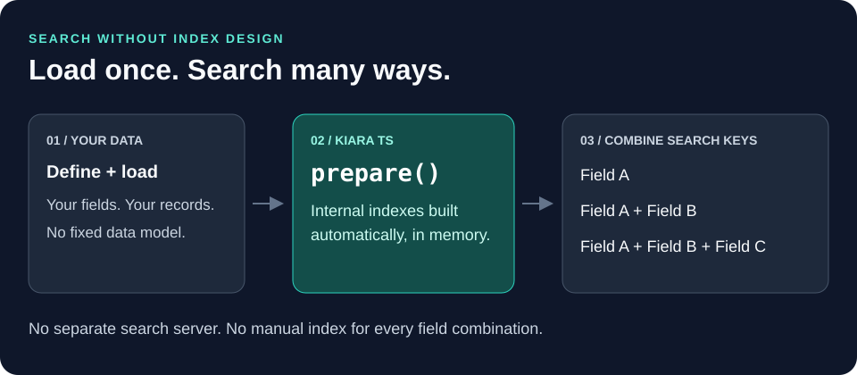
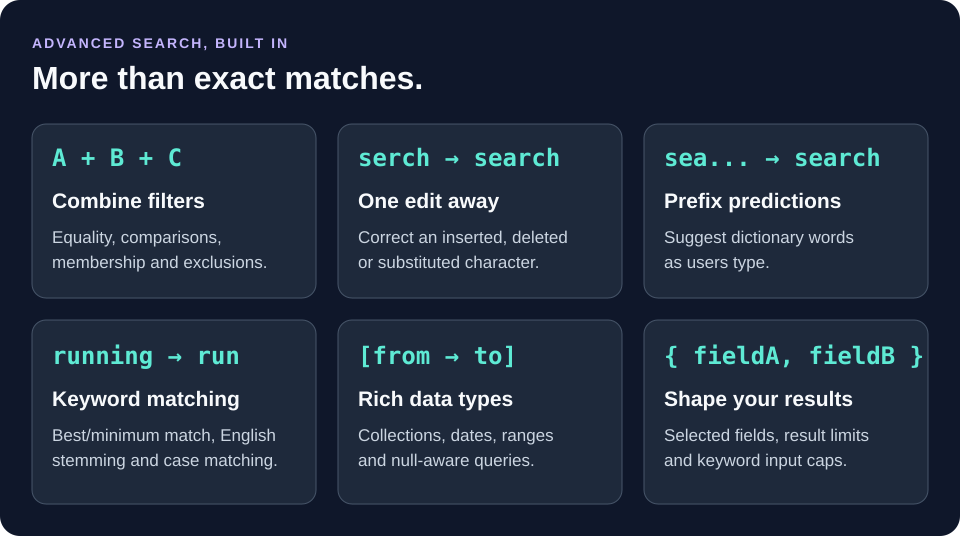

# Kiara TS (`@kapoorlabs/kiara-ts`)

Search your in-memory data by any combination of searchable fields, without
manually creating indexes for each query. Kiara TS is a browser-first TypeScript
library with zero runtime dependencies.

**Search in a few milliseconds.** In a recorded Node.js benchmark over 10,000
records, prepared searches averaged **1.92 ms**, with 95% completing in
**2.35 ms or less**. See [performance](#performance) for the workload and limits.

## Install

```bash
npm install @kapoorlabs/kiara-ts
```

## Choose your style

Both patterns use the same search engine. **You only need one.**

| Decorators: describe fields on a class | Schema builders: describe fields separately |
|---|---|
| `@Entity`, `@Text()`, `@NumberField()` | `defineSchema()`, `textField()`, `numberField()` |
| Best if you prefer annotated TypeScript models | Best for plain objects or projects without decorators |
| [Start with decorators](#decorator-quick-start) | [Start with schema builders](#schema-quick-start) |

## Table of contents

- [Why Kiara TS](#why-kiara-ts)
- [Performance](#performance)
- [Decorator quick start](#decorator-quick-start)
- [Schema quick start](#schema-quick-start)
  - [1) Create a schema and load data](#1-create-a-schema-and-load-data)
  - [2) Run structured queries](#2-run-structured-queries)
  - [3) Add keyword search with typo correction](#3-add-keyword-search-with-typo-correction)
  - [4) Use projections and limits](#4-use-projections-and-limits)
- [Worker quick start](#worker-quick-start)
- [Feature reference and detailed docs](#feature-reference-and-detailed-docs)
- [Release and package info](#release-and-package-info)

## Why Kiara TS

Your users choose the filters. You shouldn't have to design an index for every
combination. **Define your fields, load your records, and call `prepare()`**:
Kiara TS builds internal indexes so you can combine searchable fields freely.



Ideal for browser-side catalogs, filterable tables, and offline datasets.
**Automatic indexing is not index-free storage:** records and indexes must fit
in memory.



Also included: [typed schemas](#1-create-a-schema-and-load-data),
[decorators](#decorator-quick-start), [worker integration](#worker-quick-start),
configurable number handling, clear errors, and tools to inspect search indexes.
Explore the [feature reference](#feature-reference-and-detailed-docs) or
[choose a quick start](#choose-your-style).

## Performance

The [recorded benchmark](./benchmarks/last-bench-run.json) measured 200 searches
over 10,000 records in Node.js. Each search combined two filters and returned
up to 100 results.

| Measurement | Recorded time |
|---|---|
| Average search | **1.92 ms** |
| 95% of searches completed within | **2.35 ms** |
| Index preparation, measured separately | 125.38 ms |

These are measurements for one workload, not a latency guarantee. Query times
exclude loading and preparation. Dataset size, filters, result count, hardware,
and runtime affect performance; measure your own data, especially in a browser.

## Decorator quick start

Define a model, decorate its fields, then load and search. **No manual
`defineSchema()` call is needed**: `getEntitySchema()` reads the class metadata.

Use TypeScript 5+ standard decorators. Do not enable legacy
`experimentalDecorators` or `emitDecoratorMetadata`. Include
`"ESNext.Decorators"` in your TypeScript `lib` configuration alongside your
runtime libraries.

```ts
import {
  Entity,
  Text,
  NumberField,
  CaseInsensitive,
  CommaSeparatedStrings,
  Store,
  NormalizationProfile,
  getEntitySchema,
  initializeDecoratorMetadata,
  createCondition,
  Operator,
} from "@kapoorlabs/kiara-ts";

// Run before decorated classes are evaluated.
initializeDecoratorMetadata();

@Entity
class Movie {
  @Text()
  @CaseInsensitive()
  title = "";

  @NumberField()
  year = 0;

  @Text()
  @CaseInsensitive()
  @CommaSeparatedStrings()
  actors = "";

  @NumberField()
  rating = 0;
}

const store = new Store(getEntitySchema(Movie), {
  normalizationProfile: NormalizationProfile.NATIVE,
});

store.loadRow(Object.assign(new Movie(), {
  title: "Cast Away", year: 2000, actors: "Tom Hanks, Helen Hunt", rating: 8.1,
}));
store.loadRow(Object.assign(new Movie(), {
  title: "Apollo 13", year: 1995, actors: "Tom Hanks, Bill Paxton", rating: 7.6,
}));
store.prepare();

const results = store.search([
  createCondition<Movie, "actors">({
    field: "actors",
    operator: Operator.CONTAINS_EITHER,
    values: ["tom hanks"],
  }),
  createCondition<Movie, "rating">({
    field: "rating",
    operator: Operator.GREATER_THAN,
    values: [8],
  }),
]);

console.log(results.map((movie) => movie.title));
// ["Cast Away"]
```

Native numeric mode preserves decimal values. The default Java numeric mode
truncates fractional search keys.

Once prepared, this store supports the same
[keyword search](#3-add-keyword-search-with-typo-correction),
[projections](#4-use-projections-and-limits), and
[worker integration](#worker-quick-start) as a schema-built store.
See [schema and decorator setup](./docs/usage.md#schemas-and-decorators) for more.

## Schema quick start

**Schema-builder alternative:** use this pattern instead of the decorated class
above. No decorator configuration or metadata initialization is needed.

### 1) Create a schema and load data

```ts
import {
  Store,
  defineSchema,
  textField,
  numberField,
  NormalizationProfile,
} from "@kapoorlabs/kiara-ts";

type Movie = {
  title: string;
  year: number;
  actors: string;
  rating: number;
};

const movieSchema = defineSchema<Movie>([
  textField("title", { caseInsensitive: true }),
  numberField("year"),
  textField("actors", {
    secondaryType: "commaSeparatedStrings",
    caseInsensitive: true,
  }),
  numberField("rating"),
]);

const store = new Store(movieSchema, { normalizationProfile: NormalizationProfile.NATIVE });

store.loadRow({ title: "Cast Away", year: 2000, actors: "Tom Hanks, Helen Hunt", rating: 8.1 });
store.loadRow({ title: "Apollo 13", year: 1995, actors: "Tom Hanks, Bill Paxton", rating: 7.6 });
store.loadRow({ title: "Big", year: 1988, actors: "Tom Hanks", rating: 7.3 });
store.prepare();
```

### 2) Run structured queries

```ts
import { createCondition, Operator } from "@kapoorlabs/kiara-ts";

const results = store.search([
  createCondition<Movie, "year">({
    field: "year",
    operator: Operator.BETWEEN,
    lowerValue: 1990,
    upperValue: 2001,
  }),
  createCondition<Movie, "actors">({
    field: "actors",
    operator: Operator.CONTAINS_EITHER,
    values: ["tom hanks"],
  }),
]);

console.log(results.map((row) => row.title));
// ["Cast Away", "Apollo 13"]
```

### 3) Add keyword search with typo correction

```ts
import { KeywordSearch } from "@kapoorlabs/kiara-ts";

const keywordSearch = new KeywordSearch(store);
const keywordResult = keywordSearch.bestMatch("apolo", { limit: 5 });

console.log(keywordResult.correctedKeywords);
// { apolo: "apollo" }
```

### 4) Use projections and limits

Return only the fields you need (a *projection*) and cap the number of results.

```ts
const typedProjection = store.searchProjection(
  [createCondition<Movie, "actors">({ field: "actors", operator: Operator.CONTAINS_EITHER, values: ["tom hanks"] })],
  ["title", "rating"],
  2,
);

const legacyProjection = store.searchLegacyProjection(
  [createCondition<Movie, "actors">({ field: "actors", operator: Operator.CONTAINS_EITHER, values: ["tom hanks"] })],
  ["title", "year"],
  2,
);
```

## Worker quick start

Use the in-memory adapter to submit a search request and receive a result or
error response. This example continues with a store from either quick start:

```ts
import { InMemoryWorkerAdapter, WorkerOperation } from "@kapoorlabs/kiara-ts";

const worker = new InMemoryWorkerAdapter<Movie>();
worker.registerStore("movies", store);
const response = await worker.execute({
  requestId: "search-1",
  storeId: "movies",
  operation: WorkerOperation.SEARCH,
  payload: {
    conditions: [createCondition<Movie, "year">({ field: "year", values: [2000] })],
  },
});
if (!response.ok) throw new Error(response.message);
console.log(response.result);
```

This adapter runs on the current thread; it does not create a Web Worker.
See [worker integration](./docs/usage.md#workers) for background execution.

## Feature reference and detailed docs

| What you want to do | Guide |
|---|---|
| Define fields, choose numeric behavior, or use decorators | [Schemas and decorators](./docs/usage.md#schemas-and-decorators) |
| Load, prepare, and replace a dataset | [Store lifecycle](./docs/usage.md#store-lifecycle) |
| Combine filters, query collections, dates, ranges, and nulls | [Structured queries](./docs/usage.md#structured-queries) |
| Select fields and limit results | [Projections and limits](./docs/usage.md#projections-and-limits) |
| Search keywords with stemming and typo correction | [Keyword search](./docs/usage.md#keyword-search) |
| Build autocomplete suggestions | [Dictionary and autocomplete](./docs/usage.md#dictionary-and-autocomplete) |
| Execute requests in a browser worker | [Workers](./docs/usage.md#workers) |
| Handle failures and inspect a prepared store | [Errors and diagnostics](./docs/usage.md#errors-and-diagnostics) |

## Release and package info

- Package: `@kapoorlabs/kiara-ts`
- Module type: ESM (`type: module`)
- Entry points: `dist/index.js` + `dist/index.d.ts`
- Includes JavaScript and TypeScript declarations; source maps and original TypeScript sources are not included.
- License: MIT ([LICENSE](./LICENSE))

Release notes:
[CHANGELOG.md](./CHANGELOG.md)
